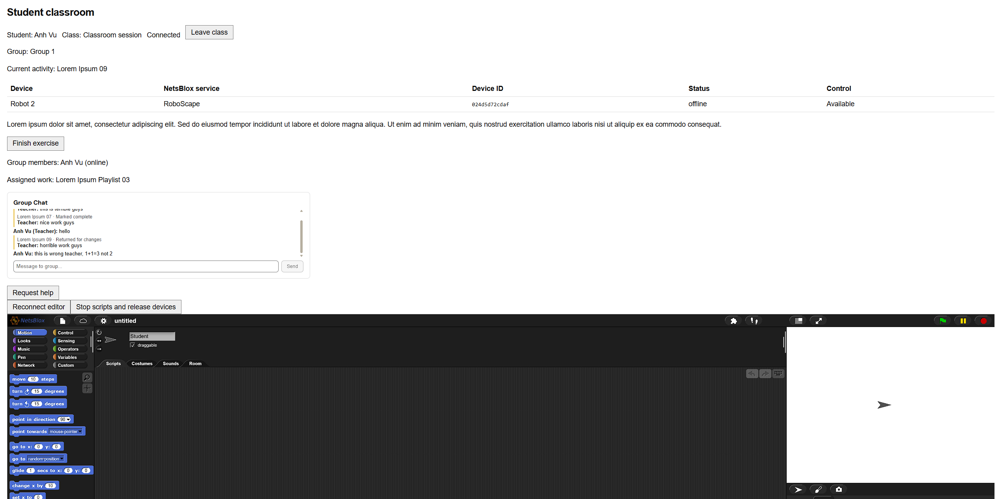

## A Centralized System for Classroom Planning, Orchestration, and Resource Management for Physical Computing Courses
A centralized classroom management system built on top of NetsBlox to support activity planning, real-time classroom orchestration, physical resource management, and infrastructure failure recovery in IoT and robotics education.

[Technical details](technical.md)

## System Interface


## Student Program Interface



## Setup

### System

Install Git, Node.js 24, and Docker with Docker Compose. Start Docker, then run in Bash (Windows: WSL):

```bash
git clone https://github.com/Shade9378/classroom-orchestration.git
cd classroom-orchestration
npm ci
cp .env.example .env
npm run db:start
npm run db:generate
npm run db:migrate
npm run dev
```

Open http://localhost:5173, create a teacher account, and create a session. Keep the terminal running. For later runs:

```bash
npm run db:start
npm run dev
```

### Student Program

With the system running, open [http://localhost:5173/student](http://localhost:5173/student), internet access is required.

### Physical Devices

Devices connect through NetsBlox services:

**Phone / tablet (PhoneIoT)**

1. Install [PhoneIoT](https://netsblox.org/phoneiot) on Android or iOS.
2. Open its menu, tap **Connect**, and copy the device ID and password.
3. In the dashboard, click **Connect device**, choose **PhoneIoT (device ID and password)**, enter those credentials and a name, then click **Connect**.

Re-enter the password after restarting the backend; it is not saved in the database. See the [PhoneIoT setup guide](https://editor.netsblox.org/docs/services/PhoneIoT/index.html).

**Robot (RoboScape)**

1. Use a [RoboScape-compatible robot](https://netsblox.org/roboscape), such as a Parallax ActivityBot 360, with RoboScape firmware and internet-connected Wi-Fi configured.
2. Complete any authorization required by your NetsBlox service host. Confirm its ID is returned by [RoboScape.getRobots](https://editor.netsblox.org/docs/services/RoboScape/index.html).
3. Click **Connect device**, choose **Registered with RoboScape or IoTScape**, select **RoboScape (robots)**, choose the device ID, enter a name, and click **Connect**.

**Sensor / other device (IoTScape)**

1. Install or implement IoTScape-compatible firmware or a network adapter for the device. Configure it to announce its service and stable device ID to the same NetsBlox service host used by this system.
2. Confirm the service appears in [IoTScape.getServices](https://services.netsblox.org/docs/services/IoTScape/index.html) and the ID appears in `getDevices(service)`.
3. Click **Connect device**, choose **Registered with RoboScape or IoTScape**, select **IoTScape (sensors and other devices)**, then select the service, ID, type, and name. Click **Connect**.

For dashboard sensor readings, expose `getReadings(id)` returning `[[name, value, unit], ...]`, for example `[["temperature", 22, "deg C"], ["humidity", 45, "% RH"]]`. Optionally expose `getBatteryLevel(id)` returning a percentage. Device RPCs must take `id` as their first argument. A bare sensor without compatible firmware or an adapter will not appear automatically.

For a custom NetsBlox host, set `NETSBLOX_SERVICES_URL` in `.env` and restart the backend. After connecting, use **Group Assignments => Resource Allocation** to assign devices to groups.

## Acknowledgements

This project integrates and customizes the [NetsBlox editor](https://github.com/NetsBlox/Snap--Build-Your-Own-Blocks) and uses its RoboScape, IoTScape, and PhoneIoT services, developed by the NetsBlox team at Vanderbilt University, led by [Akos Ledeczi](https://computing.vanderbilt.edu/person/akos-ledeczi/).
