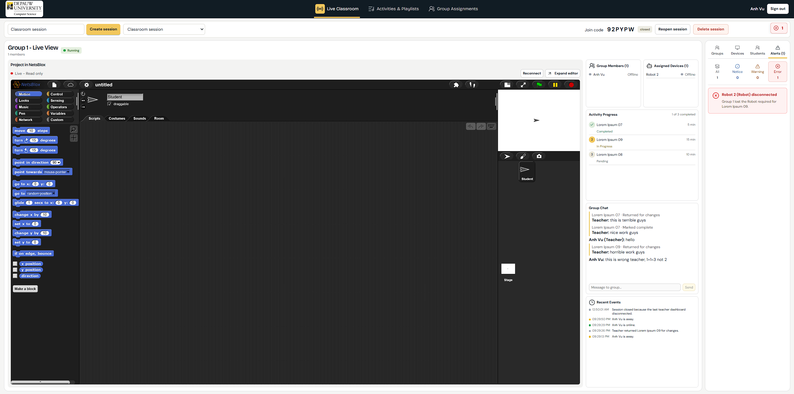
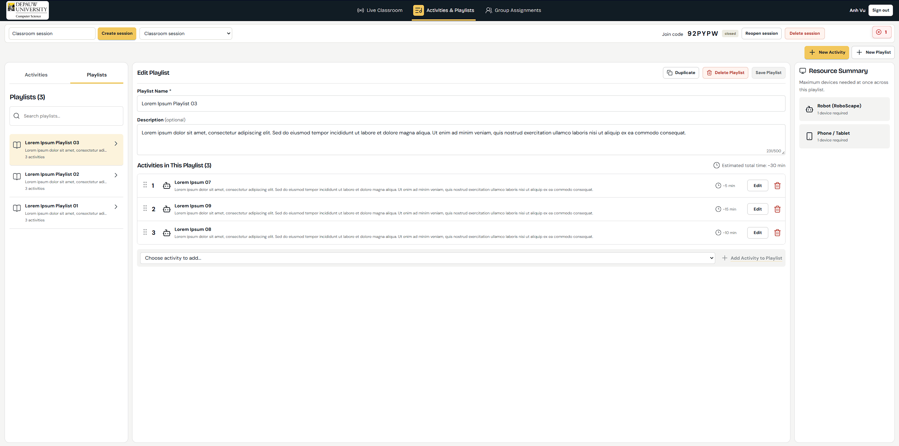

## A Centralized System for Classroom Planning, Orchestration, and Resource Management for Physical Computing Courses

## System Interface






## Student Program Interface


## Setup

### System

Install Git, Node.js 24, and Docker with Docker Compose. Start Docker, then run in Bash (Windows: WSL):

```bash
git clone https://github.com/Shade9378/classroom-orchestration.git
cd classroom-orchestration
npm ci
cp .env.example .env
npm run db:start
npm run db:generate
npm run db:migrate
npm run dev
```

Open http://localhost:5173, create a teacher account, and create a session. Keep the terminal running. For later runs:

```bash
npm run db:start
npm run dev
```

### Student Program

No separate installation or server. With the system running, open http://localhost:5173/student, enter the teacher's join code and your name, then click **Join class**. The NetsBlox editor opens after joining; internet access is required.

For students on other computers, run the API and frontend in separate terminals instead of `npm run dev`:

```bash
npm run dev:api
```

```bash
npm run dev:web -- --host 0.0.0.0
```

On the same network, students open `http://<teacher-computer-IP>:5173/student`. Allow port 5173 through the firewall. In WSL, also forward that port or use mirrored networking.
