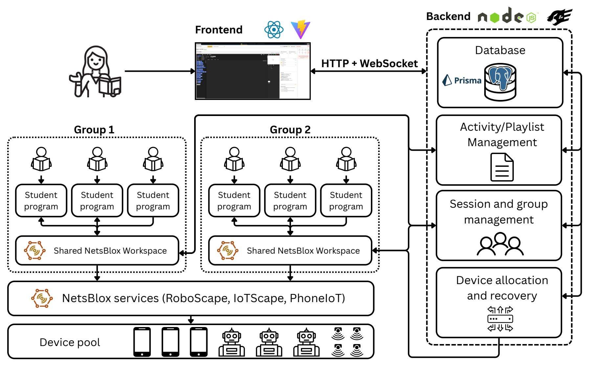
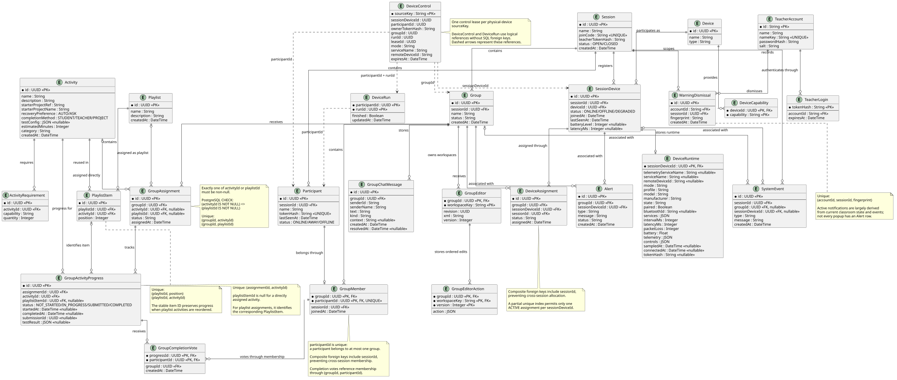

# Technical Details

## Tech Stack

| Purpose | Framework / Technology |
| --- | --- |
| Main language | TypeScript |
| Student IDE | NetsBlox |
| NetsBlox integration | Services / RPCs |
| Device connectivity | PhoneIoT, IoTScape, RoboScape |
| Realtime communication | WebSockets |
| Backend | Node.js, Fastify |
| Frontend | React, Vite |
| Database | PostgreSQL, Prisma |
| Schema validation | Zod |
| Deployment | Docker Compose |
| Testing | Vitest, Playwright |

The stack follows the proposal. Docker Compose currently runs PostgreSQL; the frontend and backend run through npm.

## High-Level Architecture

The React dashboard sends HTTP requests to the Fastify backend. Zod validates requests, Prisma accesses PostgreSQL, and WebSocket notifications keep connected interfaces updated.

Each student uses a browser wrapper containing a NetsBlox editor. The wrapper joins a session and sends presence updates. Group members have separate editor instances; editor actions synchronize asynchronously through the backend into a shared workspace. The shared workspace represents the synchronized group project. Device commands from the managed editor pass through backend access checks and control locks, then NetsBlox services to the device.

The backend manages activities, playlists, sessions, groups, progress, device assignments, and alerts. When an assigned device disconnects, it checks compatible replacements and requests teacher approval before switching to another device.

## Database Schema

The [Prisma schema](prisma/schema.prisma) is the authoritative definition of current models, fields, and relationships. [Database migrations](prisma/migrations) contain additional SQL constraints and indexes.

## Limitations

- NetsBlox editing and device services require internet access and an available service host. Device status reflects service responses, not a direct physical connection check.
- Devices need compatible firmware, an adapter, or PhoneIoT. The dashboard does not provide general Bluetooth discovery or firmware installation.
- PhoneIoT passwords are held in backend memory and must be entered again after a backend restart. The current phone command interface supports selected sensor RPCs.
- Telemetry depends on what the integration exposes. Battery shows unavailable when no reading is supplied; not every robot or phone provides it.
- Control locks coordinate commands routed through this application. They do not block clients that contact NetsBlox services independently.
- Automatic tests check configured NetsBlox reporter inputs and expected outputs; arbitrary physical tasks need teacher review or additional task-specific checks.
- Opening the student program from another computer requires network access to the system. `localhost` refers to that student's own computer.
- Local simulator discovery is disabled by default and is unavailable in production. Real hardware should be verified with its supported service before classroom use.
